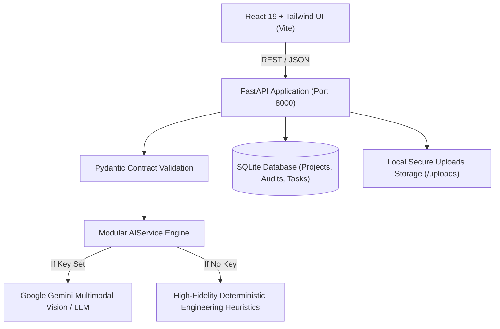

# BuildMind AI: Multimodal Construction Intelligence Platform

[](https://react.dev/)
[](https://tailwindcss.com/)
[](https://fastapi.tiangolo.com/)
[](https://python.org/)
[](https://sqlite.org/)
[](LICENSE)

An enterprise-grade, full-stack **AI-Powered Multimodal Construction Intelligence Platform** designed for site superintendents, project managers, and civil/structural forensic engineers. BuildMind AI unifies computer-vision safety monitoring, structural crack diagnostics, econometric real estate valuation, and CPM Gantt scheduling into a single, cohesive command center.

---

## 🏗️ Key Modules & Capabilities

| Module | Core Functionality | Primary Tech / Model |
|---|---|---|
| **1. Landing Page** | Commercial SaaS overview, architectural highlights, quick launchpad | React + Tailwind |
| **2. Intelligence Dashboard** | Real-time aggregated KPIs, safety risk distribution donut, project progress charts, recent activity feed | Recharts, REST Telemetry |
| **3. Safety Monitoring** | Computer-vision site hazard detection (scaffolding, trenching, PPE compliance, electrical hazards), OSHA 1926 checklist, PDF report generator | Multimodal Vision AI / Heuristics Engine |
| **4. Crack & Structural Health** | Structural crack scan, aperture width estimation (mm), shear vs flexural classification, PE testing protocols | Computer Vision / Forensic Rules |
| **5. Real Estate Valuation** | Parametric hedonic regression valuation model, price/sq.ft estimation, 90% confidence corridor, depreciation calculation | Statistical Cost Regression Model |
| **6. Project Planning (CPM)** | Master Work Breakdown Structure (WBS), interactive horizontal Gantt chart, task progress updater, AI Schedule Synthesizer | Dynamic Critical Path Scheduler |
| **7. Daily Site Assistant** | Conversational superintendent copilot with preset inquiries, concrete slump standards, and OSHA toolbox talks | LLM Chat Assistant / Rule Engine |
| **8. Weather-Aware Advisory** | Site atmospheric evaluation, wind threshold checks for crane lifts (38 km/h limit), concrete pour curing risks | Weather Telemetry & Advisory Engine |
| **9. Knowledge Base** | Curated civil engineering standards (ACI 308R, ASTM C143, OSHA 1926 Subpart P), terminology glossary, search | Categorized Technical Library |
| **10. Reports & Analysis** | Unified archive of all safety, structural, and valuation audits with print-to-PDF and JSON export capabilities | Local SQLite Audit Store |
| **11. Settings & Diagnostics** | Backend health checks, API key status verification, and architecture documentation | Health Diagnostic API |

---

## 🏛️ System Architecture



### Safety & AI Integrity Principles
- **No Mock Pretending:** If no API key is configured, the system explicitly labels outputs as `DEMO MODE` and states that results are simulated.
- **Mandatory Engineering Disclaimers:** All safety scans and structural crack assessments include visible disclaimers stating that preliminary AI outputs must be physically verified by a qualified OSHA officer or licensed Structural Engineer.
- **Zero Client-Side Secret Leakage:** All API keys are securely housed in the backend `.env` file and never exposed to client-side bundles.

---

## 📁 Project Structure

```
SkillWallet/
├── backend/
│   ├── app/
│   │   ├── api/
│   │   │   └── endpoints.py       # All REST API endpoints with Pydantic validation
│   │   ├── core/
│   │   │   ├── config.py          # Environment settings & constraints
│   │   │   └── database.py        # SQLite database connection & schema tables
│   │   ├── models/
│   │   │   └── schemas.py         # Request & response strict JSON schemas
│   │   ├── services/
│   │   │   ├── ai_service.py      # Multimodal AI caller with realistic demo fallback
│   │   │   └── seed_data.py       # Seed data for projects, tasks, & knowledge base
│   │   └── main.py                # FastAPI entrypoint, CORS & static file mounting
│   ├── data/
│   │   └── construction_intelligence.db
│   ├── uploads/                   # Uploaded inspection imagery
│   ├── requirements.txt           # Python backend dependencies
│   ├── .env.example
│   └── .env
├── frontend/
│   ├── src/
│   │   ├── components/            # Reusable design system components
│   │   │   ├── Sidebar.jsx        # Dark navy collapsible navigation
│   │   │   ├── TopNavbar.jsx      # Global search, weather ticker, notifications
│   │   │   ├── MetricCard.jsx     # KPI stat card with colored accents
│   │   │   ├── StatusBadge.jsx    # Risk & progress badges
│   │   │   ├── ImageUploadZone.jsx# Drag & drop with 1-click sample images
│   │   │   ├── ToastContainer.jsx # Toast notifications
│   │   │   ├── DemoDisclaimer.jsx # Regulatory & verification disclaimer banner
│   │   │   └── PrintableReportModal.jsx # Official printable PDF report view
│   │   ├── context/
│   │   │   └── AppContext.jsx     # Global state, health telemetry, sample data
│   │   ├── layouts/
│   │   │   └── MainLayout.jsx     # Shared layout structure
│   │   ├── pages/                 # All 11 dedicated application pages
│   │   ├── services/
│   │   │   └── api.js             # Centralized API client with fallback handling
│   │   ├── App.jsx                # Client-side router
│   │   ├── index.css              # Global styles, fonts & print stylesheets
│   │   └── main.jsx
│   ├── tailwind.config.js
│   ├── postcss.config.js
│   ├── package.json
│   ├── .env.example
│   └── .env
├── .gitignore
└── README.md
```

---

## 🚀 Quickstart Guide (Local Setup on Windows)

### Prerequisites
- **Python 3.10+** (Tested on Python 3.13)
- **Node.js 18+** and **npm**

### Step 1: Start the FastAPI Backend
Open a PowerShell terminal in the repository root:

```powershell
cd backend

# 1. Install backend requirements
pip install -r requirements.txt

# 2. Configure environment file (leave keys blank for demo mode)
cp .env.example .env

# 3. Start the FastAPI server
python -m uvicorn app.main:app --host 127.0.0.1 --port 8000 --reload
```
*The backend will be available at `http://127.0.0.1:8000` with interactive Swagger docs at `http://127.0.0.1:8000/docs`.*

---

### Step 2: Start the React Frontend
Open a second PowerShell terminal in the repository root:

```powershell
cd frontend

# 1. Install frontend packages
npm install

# 2. Start the Vite dev server
npm run dev -- --host 127.0.0.1 --port 5173
```
*The frontend will launch at `http://127.0.0.1:5173/`.*

---

## 🔑 Environment Variables Configuration

### Backend (`backend/.env`)
```env
# AI Vision & Language Provider (Optional: leave blank for deterministic Demo Mode)
GEMINI_API_KEY=
OPENAI_API_KEY=
OPENWEATHER_API_KEY=

# Server Configuration
PORT=8000
HOST=0.0.0.0
```

### Frontend (`frontend/.env`)
```env
# API Base URL pointing to the FastAPI backend
VITE_API_BASE_URL=http://localhost:8000/api
```

---

## 🧪 Feature Testing Walkthrough

1. **Verify Intelligence Dashboard (`/dashboard`)**:
   - Check the 5 KPI summary cards (Active Projects, Safety Inspections, High Risk Findings, Structural Scans, Avg Completion).
   - Filter by specific project (e.g., *Skyline Heights Tower C*) to observe dynamic chart re-filtering.
   - Review the *Safety Risk Distribution* donut and *Project Progress* bar chart.

2. **Test Safety Monitoring (`/safety`)**:
   - Click the 1-click sample button **"Scaffolding Deck Hazard (Demo)"**.
   - Notice the preview image loads and parameters populate automatically.
   - Click **Run Safety Intelligence Scan**.
   - Observe the **HIGH Risk** result, 3 detailed OSHA observations, potential secondary hazards, and mandatory PPE checklist.
   - Click **Generate Official Report** to inspect the printable PDF-style modal, then export as JSON or print.

3. **Test Structural Crack Inspection (`/structural`)**:
   - Click the sample button **"Diagonal Beam Shear Crack (Demo)"**.
   - Click **Execute Structural AI Scan**.
   - Review the calculated aperture width ($0.65\text{ mm}$), crack pattern classification (Diagonal Shear), and suggested PE testing steps.

4. **Test Real Estate Valuation (`/valuation`)**:
   - Enter built-up area ($2,400\text{ sq.ft}$), quality grade (*Premium*), and select amenities.
   - Click **Generate Valuation Estimate**.
   - Observe the estimated market value, price/sq.ft, conservative vs. optimistic price corridor, and sensitivity weights.

5. **Test CPM Project Planning (`/planning`)**:
   - Select an active project from the top selector cards.
   - Inspect the interactive Gantt chart schedule.
   - Click the progress update buttons ($0\%$, $50\%$, $100\%$) on any task to test instant progress updates.
   - Click **AI Schedule Synthesizer** to generate a master WBS with conflict detection.

6. **Test Daily Site Assistant (`/assistant`)**:
   - Click one of the quick prompts (e.g., *"Draft a 10-minute morning toolbox talk on scaffolding fall arrest"*).
   - Review the formatted construction supervisor briefing.

7. **Test Weather-Aware Advisory (`/weather`)**:
   - Click preset location chips (*"Coastal Port Pier 4"* or *"Industrial Valley Corridor"*).
   - Observe the wind speed evaluation and activity impact matrix (concrete pouring, painting, roofing, crane lifts).

---

## 🌐 Public Deployment Guide

### Deploying the Frontend (Vercel / Netlify)
1. Push your repository to GitHub.
2. Sign in to [Vercel](https://vercel.com/) and click **Add New Project**.
3. Select your repository, set the **Root Directory** to `frontend`.
4. Add the environment variable:
   ```env
   VITE_API_BASE_URL=https://your-backend-service.onrender.com/api
   ```
5. Click **Deploy**.

### Deploying the Backend (Render / Railway)
1. In [Render](https://render.com/), create a new **Web Service**.
2. Connect your GitHub repository and set **Root Directory** to `backend`.
3. Set **Runtime** to `Python 3`.
4. Set **Build Command**:
   ```bash
   pip install -r requirements.txt
   ```
5. Set **Start Command**:
   ```bash
   uvicorn app.main:app --host 0.0.0.0 --port $PORT
   ```
6. (Optional) Add your `GEMINI_API_KEY` under Environment Variables.
7. Deploy the service and update your frontend's `VITE_API_BASE_URL` with your Render URL.

---

## 📦 Pushing to GitHub

```powershell
# 1. Initialize git if not already present
git init

# 2. Add all tracked files
git add .

# 3. Commit changes
git commit -m "feat: initial commit of AI-Powered Multimodal Construction Intelligence Platform"

# 4. Add remote repository and push
git remote add origin https://github.com/<your-username>/construction-intelligence-platform.git
git branch -M main
git push -u origin main
```

---

## ⚖️ Implemented Features & Known Limitations

### Implemented Features
- [x] Complete MVP with all 11 dedicated application pages.
- [x] Responsive layout with collapsible dark navy sidebar and mobile drawer.
- [x] Real-time Recharts visualizations for risk distribution and project progress.
- [x] Computer vision safety monitoring with sample photo selector.
- [x] Concrete crack forensics and aperture measurement.
- [x] Parametric real estate valuation estimator.
- [x] Interactive horizontal Gantt chart and CPM task tracker.
- [x] Conversational site assistant copilot with session history.
- [x] Weather-aware activity advisory for crane, concrete, and roofing work.
- [x] Official printable PDF report generator with download and print capabilities.
- [x] Local SQLite persistence with pre-seeded demo projects and past inspections.

### Known Limitations
- The visual crack aperture width measurement is an approximation based on 2D image pixel ratios; micro-meter crack gauges (tell-tales) or ultrasound testing are still required on physical sites.
- Weather data defaults to simulated realistic scenarios unless an `OPENWEATHER_API_KEY` is provided.
- Live LLM multimodal vision requires a valid `GEMINI_API_KEY` or `OPENAI_API_KEY` in `backend/.env`; otherwise, the platform operates in full deterministic demo mode.

---

## 📄 License
This project is licensed under the MIT License - see the LICENSE file for details.
